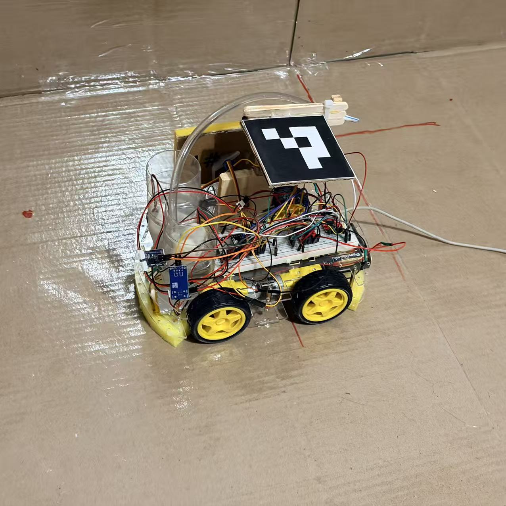

# BioGuard · Hospital Guardian

**A camera-guided cleaning robot prototype for natHacks 2026.**

BioGuard combines a fixed camera, computer vision, closed-loop navigation, and an ESP32 controller to detect new spills and guide a robot through a cleaning demonstration. The Python application locates spills and tracks the robot; the ESP32 executes timed movement commands and onboard cleaning presets. A browser dashboard displays annotated video, tasks, and progress.

This is a hackathon prototype. Red/non-red labels select demonstration priority and cleaning-fluid presets; they do not identify blood or other medical substances. Clinical cleaning effectiveness has not been validated.



[Quick start](#quick-start) · [System architecture](#system-architecture) · [Hardware setup](#hardware-setup) · [Physical operation](#physical-operation) · [Documentation](#documentation)

## What the project does

- Detects newly introduced spills against a registered clean background and confirms detections across consecutive frames.
- Converts detections into separate floor and wall coordinates.
- Tracks robot position and heading using an ArUco marker and a measured mapping at the marker's mounting height.
- Prioritizes red spills, evaluates approach poses, and checks body and tool clearance.
- Uses camera feedback to guide duration-limited movements and verify arrival.
- Hands cleaning execution to the ESP32, waits for completion, and scans for the next target. Returning home after each task is optional.
- Provides hardware-free simulation and a Flask dashboard with DEMO and LIVE monitoring modes.

## Current status

The repository contains Modules 01–07, the dashboard, automated tests, synthetic demonstration assets, and development reports. The following summarizes the recorded project evidence as of November 9, 2026; these results were not rerun while rewriting this README.

| Area | Recorded status |
| --- | --- |
| Software workflow | Detection, prioritization, planning, navigation, cleaning completion, and consecutive targets implemented in simulation |
| Robot localization | Operator-confirmed physical validation using four training points and three independent validation points: **1.045 cm RMS error**, **1.253 cm maximum error** |
| Robot communication | Physical TCP, PING/CAPS, and MOVE execution records reported |
| Complete physical workflow | Detection → navigation → cleaning → next target has **not been established as a verified end-to-end physical result** |
| Cleaning geometry | Some physical tool measurements remain incomplete; parking checks do not establish spray or contact coverage |
| Dashboard | DEMO and non-actuating LIVE monitoring implemented; LIVE streams the shared OpenCV annotation pipeline |
| Firmware in this repository | Imported reference sources include an incomplete older sketch; verify the actual device firmware before physical use |

Localization accuracy applies only to the measured camera, scene, marker, and mounting geometry. A successful simulation or completed cleaning preset does not establish physical arrival accuracy or spill removal.

## Quick start

### 1. Install the computer application

The primary development platform is macOS on Apple Silicon. Python 3.12 is recommended; project documentation also lists Python 3.11 support.

```bash
git clone https://github.com/2226442613/nathacks-2026-project.git
cd nathacks-2026-project

python3.12 -m venv .venv
source .venv/bin/activate
python -m pip install --upgrade pip
python -m pip install -r requirements-dashboard.txt
python main.py --help
```

The dashboard requirements include the base dependencies: OpenCV contrib, NumPy, and pytest, plus Flask. For CLI-only use, install `requirements.txt` instead. Use `opencv-contrib-python` without installing another package that also provides `cv2`; the camera preview commands require native GUI support.

Run the commands below from the repository root with the virtual environment activated.

### 2. Open the hardware-free dashboard

```bash
python main.py dashboard --mode demo \
  --calibration data/module03_demo/calibration.json --port 5050
```

Open [http://127.0.0.1:5050](http://127.0.0.1:5050) on the same computer. Use **Play** and **Step** to explore simulated detections, task priority, and history. DEMO opens neither a camera nor a robot connection. The explicit calibration path selects the bundled synthetic scene.

### 3. Simulate the automatic workflow

```bash
python main.py auto-clean --mode simulation --max-tasks 2
```

This uses synthetic observations and a simulated robot. The documented successful outcome is `READY` with `completed=2`. Add `--return-home` to exercise the legacy return-home workflow after each cleaning task.

## System architecture

```text
Fixed camera
    ├── Spill detection → floor/wall localization ──┐
    └── ArUco tracking → robot position and heading ┤
                                                   ▼
                                      Approach and clearance planning
                                                   ▼
                                      Closed-loop navigation on computer
                                                   │ Wi-Fi / TCP 3333
                                                   ▼
                                      ESP32 movement and cleaning presets
                                                   │ completion events
                                                   └──────────→ computer

Dashboard ← annotated camera frames, task state, and progress
```

| Module | Responsibility | Main code |
| --- | --- | --- |
| 01 · Camera calibration | Capture, floor/wall calibration, coordinate transforms | `vision/camera.py`, `vision/calibration.py` |
| 02 · Spill detection | Background comparison, color labels, temporal confirmation | `vision/spill_detection.py`, `vision/spill_tracking.py` |
| 03 · Surface localization | Surface classification, coordinates, contours, dimensions | `vision/localization.py`, `vision/target_geometry.py` |
| 04 · Robot localization | ArUco tracking, robot center/heading, fixed-height mapping | `vision/robot_tracking.py`, `vision/robot_plane.py` |
| 05 · Cleaning geometry | Approach poses, tool geometry, clearance and reachability | `vision/cleaning_planner.py`, `navigation/adapters.py` |
| 06 · Navigation | Timed movement, camera feedback, arrival checks, task sequencing | `navigation/controller.py`, `navigation/automatic.py` |
| 07 · Communication | Protocol negotiation, command framing, outcomes, simulation | `robot_comm/` |
| Dashboard | DEMO, LIVE video, tasks, history, and progress | `dashboard/` |

Target coordinates stay on the computer. The ESP32 receives movement commands and surface/fluid labels, then runs its own cleaning sequence. The dashboard is a display and task-management service; it does not start robot motion or cleaning.

## Hardware setup

The physical system uses a fixed camera, a computer running Python, and a Wi-Fi-connected ESP32 robot with drive motors and cleaning actuators. The imported firmware references Arduino ESP32 Wi-Fi support and ESP32Servo. See [hardware notes](hardware/README.md) for the available hardware documentation.

The recorded prototype configuration is:

| Item | Recorded value |
| --- | --- |
| Camera frame | 1280 × 720 pixels |
| Floor area | 121.6 × 68.4 cm |
| Wall area | 121.6 × 31.5 cm |
| Robot body | 26 × 15.2 cm |
| ArUco marker | `DICT_4X4_50`, ID `0`, 9 cm black square |
| Marker mounting height | 16.6 cm |
| Forward / reverse timing | Approximately 16 / 18.5 cm per second |
| Left / right turn timing | Approximately 4000 / 3000 ms per 90° |

These are measurements for one apparatus, not universal defaults. Motion timing estimates require camera feedback. Floor coordinates use `(X, Y)` in centimeters; wall coordinates use `(X, H)`, with height measured upward from the wall base.

### Calibration and local data

A physical setup needs compatible camera calibration, a clean-background image and its metadata, robot mapping, motion timing, and measured tool geometry. The repository includes configuration files and synthetic examples, but the large raw camera datasets, runtime evidence, and local backups were excluded from the upload. Do not assume bundled measurements are valid for a different setup.

| File | Purpose |
| --- | --- |
| `config/camera_config.json` | Scene calibration |
| `config/robot_config.json` | Marker dimensions, mounting geometry, offsets, body dimensions |
| `config/robot_marker_plane.json` | Measured robot-marker mapping |
| `config/spill_config.json` | Detection and confirmation parameters |
| `config/localization_config.json` | Surface localization parameters |
| `config/movement_timing.json` | Direction-specific motion timing |
| `config/navigation_config.json` | Pose freshness, tolerances, motion limits |
| `config/cleaning_hardware.json` | Physical body and tool geometry |
| `config/cleaning_demo.json` | Simulation geometry |
| `data/iphone_reference.png` and its `.json` metadata | Local registered background; restore or capture for the physical scene |

For a new scene, inspect the camera and create calibration and background files using distinct filenames:

```bash
python main.py preview --camera 0
python main.py calibrate --camera 0 --dual-plane --floor-boundary top \
  --config config/camera_config_NEW.json --grid
python main.py background-reference --camera 0 --confirm-clean \
  --output data/legal_reference_NEW.png
python main.py calibrate-robot-interactive --help
```

Supply the measured scene dimensions when prompted, and pass your new paths to subsequent commands. Register the background only when the scene is clean. Preserve existing validated files; moving the camera or changing resolution, crop, marker size, or mounting height requires checking calibration compatibility.

## Camera monitoring

Once the scene calibration, background, and robot mapping match the physical setup, run the combined vision view:

```bash
python main.py test-vision --camera 0
```

The view overlays robot pose, marker ID, spill labels, confirmation state, and localization diagnostics. Press **Q** to exit. It does not connect to the ESP32.

For browser-based monitoring:

```bash
python main.py dashboard --mode live --camera 0 \
  --width 1280 --height 720 --port 5050
```

LIVE streams OpenCV-annotated frames through MJPEG and does not command the robot. Browser tabs share one camera pipeline within the dashboard process. An independent `test-vision` or `auto-clean` process does not share that camera: stop LIVE before starting another camera-based command. On macOS, grant camera access to the application launching Python and verify the camera index.

## Physical operation

Physical commands require a supervised, calibrated apparatus and firmware matching the expected protocol. They can move motors and operate cleaning actuators. Verify the installed firmware and current ESP32 IP address first; the incomplete archived sketch is not a ready-to-flash release.

### Check communication without movement

Replace `ESP32_IP` with the address reported by the robot:

```bash
python main.py robot-client --mode physical --firmware-profile simple \
  --host ESP32_IP --port 3333 \
  --command PING --command CAPS --command STATUS
```

### Run a supervised navigation-only test

After checking the scene, route, robot reference, and parked tools, isolate cleaning-actuator power before running:

```bash
python main.py auto-clean --mode physical --navigation-only \
  --host ESP32_IP --port 3333 --camera 0 --confirm-navigation-test
```

This selects a detected target, checks the parking pose, and returns home without sending the cleaning handoff commands. The confirmation flag records the operator's checks; it does not perform them.

### Run the cleaning workflow

After communication, supervised navigation, and the onboard cleaning preset have been checked:

```bash
python main.py auto-clean --mode physical \
  --host ESP32_IP --port 3333 --camera 0 \
  --background data/iphone_reference.png --confirm-clean \
  --authorize-motion --confirm-fixed-camera \
  --confirm-ground-reference --confirm-static-tools
```

The workflow confirms spills, prioritizes red targets, plans an approach, and checks arrival using fresh camera observations. For floor targets, the approach aims to leave approximately 5 cm between the front bumper and the nearest spill boundary. Wall approaches use separate tool geometry.

After arrival, the computer sends `TARGET` and `ARRIVED`, then waits for `DONE,CLEANING`. It reacquires the robot pose before continuing to another target. Add `--return-home` for the legacy per-task round trip; default operation continues from the observed post-cleaning position. Use `--max-tasks` to limit a batch.

Pose loss, uncertain communication, or failed stop verification interrupts the task. Movement acceptance is distinct from completion and camera-verified arrival. The SIMPLE protocol has no latched emergency-stop or heartbeat-watchdog capability; software STOP is not a hardware emergency stop.

Runs write `wire.log`, `progress.jsonl`, and `summary.json` under `data/auto_navigation_<run-id>/`. `NO_CONFIRMED_SPILL` means the observation window produced no confirmed target; `NO_REACHABLE_TARGET` means confirmed targets had no acceptable plan. `READY` describes task processing, not verified spill removal or a verified return home.

## ESP32 protocol and firmware

The computer-side automatic workflow expects **NATHACK_V2_SIMPLE** over TCP port **3333**, using ASCII lines terminated with LF (`\n`).

| Command | Expected response or meaning |
| --- | --- |
| `PING` | `PONG` |
| `CAPS` | Advertises `NATHACK_V2_SIMPLE`, duration-based MOVE, fixed PWM 170, STOP, TARGET, ARRIVED |
| `STATUS` | Cleaning-state report |
| `MOVE,<F/B/L/R>,<duration_ms>` | `OK,MOVE` on acceptance; `DONE,MOVE` after normal completion |
| `STOP` / `ABORT` | `OK,STOP`; an interrupted MOVE does not receive a normal completion event |
| `TARGET,<GROUND/WALL>,<BLOOD/OTHER>` | Registers the cleaning preset category; does not transmit coordinates |
| `ARRIVED` | Starts the preset; successful completion produces `DONE,CLEANING` |
| `ERR,...` | Rejection or failure |

`BLOOD` is the protocol label selected for a red demonstration spill. It is not a medical classification. The firmware protocol permits 1–10000 ms MOVE durations, while the computer applies stricter navigation limits. `OK,MOVE` does not mean arrival, and `DONE,CLEANING` does not mean the robot is home.

**Firmware compatibility matters.** The imported [`firmware/NatHack_Robot/`](firmware/NatHack_Robot/) sketch identifies itself as V1 and lacks the matching `Protocol.h` and implementation. Its parameters differ from the V2 SIMPLE guide. Other firmware references and patches are also retained in `firmware/`; check their provenance and compatibility before use. The repository also contains a separate `safe_v1_1` client/simulator profile whose capabilities must not be mixed with SIMPLE.

Read the [firmware notes](firmware/NatHack_Robot/README.md) and [SIMPLE integration guide](docs/NatHack_电脑端对接指导.md) before building or flashing. Keep actual Wi-Fi credentials outside the repository.

## Testing

```bash
python -m pytest -q
```

The suite covers vision, geometry, navigation state, communication outcomes, and dashboard behavior. Some communication tests bind local loopback ports and need an environment that permits it.

For the dashboard and shared vision pipeline:

```bash
python -m pytest -q tests/test_dashboard_live_stream.py \
  tests/test_dashboard.py tests/test_dashboard_isolation.py \
  tests/test_live_vision.py tests/test_live_detection_regressions.py
```

Module reports contain historical test results and their scope. Those counts are not a new full-suite result, and simulation tests do not validate physical actuators or cleaning performance.

## Repository layout

```text
main.py                 Command-line entry point
vision/                 Calibration, detection, localization, annotation
navigation/             Planning, closed-loop control, task sequencing
robot_comm/             TCP client, protocol profiles, simulator, logging
dashboard/              Flask application, templates, browser assets
config/                 Scene, robot, detection, tool, and navigation settings
data/module03_demo/     Bundled synthetic demonstration assets
firmware/               Imported firmware references and historical patches
hardware/               Hardware notes and schematic placeholders
assets/                 Project images
scripts/                Supporting scripts, including the older PC test client
tools/                  Sample generation and diagnostic utilities
tests/                  Automated tests
docs/                   Integration documentation
```

## Documentation

| Resource | Contents |
| --- | --- |
| [Presentation](BioGuard_natHacks_2026_Under_5_Min.pptx) | Project slide deck |
| [Autonomous MVP report](AUTONOMOUS_MVP_REPORT.md) | Consecutive-target workflow, fixes, regression evidence, and physical validation limits |
| [Camera field report](MODULE02_REAL_CAMERA_REPORT.md) | Real-camera spill-detection observations |
| [Robot localization](MODULE04_REPORT.md) / [Calibration wizard](MODULE04_WIZARD_REPORT.md) | Marker mapping, measurements, and validation process |
| [Cleaning geometry](MODULE05_REPORT.md) | Floor/wall planning and required measurements |
| [Navigation](MODULE06_REPORT.md) / [Hybrid navigation](MODULE06_HYBRID_REPORT.md) | Control design and development results |
| [Navigation-only testing](MODULE06_NAVIGATION_TEST_REPORT.md) | Supervised physical test procedure |
| [Dashboard](DASHBOARD_REPORT.md) | DEMO/LIVE behavior and focused verification |
| [Physical measurements](PHYSICAL_MEASUREMENTS_REPORT.md) | Recorded hardware dimensions and missing measurements |
| [Skipped-target investigation](SKIPPED_TARGET_20261109_073050_REPORT.md) | Rejected plans and evidence gaps |
| [Historical module reference](README_MODULE_REFERENCE.md) | Earlier detailed CLI/API documentation; compare against current source |

Some supporting reports are in Chinese. For current command options, use `python main.py <command> --help`.

## Troubleshooting

| Symptom | What to check |
| --- | --- |
| Camera unavailable or black frame | macOS permissions, camera index, Continuity Camera connection, competing applications |
| LIVE has no video | Server errors, calibration/background paths, camera availability; use **Retry monitoring** after recovery |
| `UNVERIFIED` robot pose | Mapping, scene, marker dimensions/height, and measurement-session compatibility |
| `MARKER_NOT_VISIBLE` or `STALE_POSE` | Occlusion, motion blur, reflections, capture delay |
| `NO_REACHABLE_TARGET` | Candidate rejection details in `[PLAN]` logs, tool geometry, boundaries, and movement clearance |
| `CONFIGURATION_REQUIRED` | Missing measured tool dimensions or offsets; demonstration geometry is not a physical substitute |
| MOVE accepted but no completion | STOP events, errors, disconnects, and timeouts; an uncertain MOVE must not be blindly repeated |
| Capability mismatch | Actual installed firmware and selected protocol profile |

Keep calibration, clean-background images and metadata, measured mappings, and necessary run evidence backed up separately. The uploaded source and synthetic demo assets do not replace the records needed to reproduce a physical setup.
