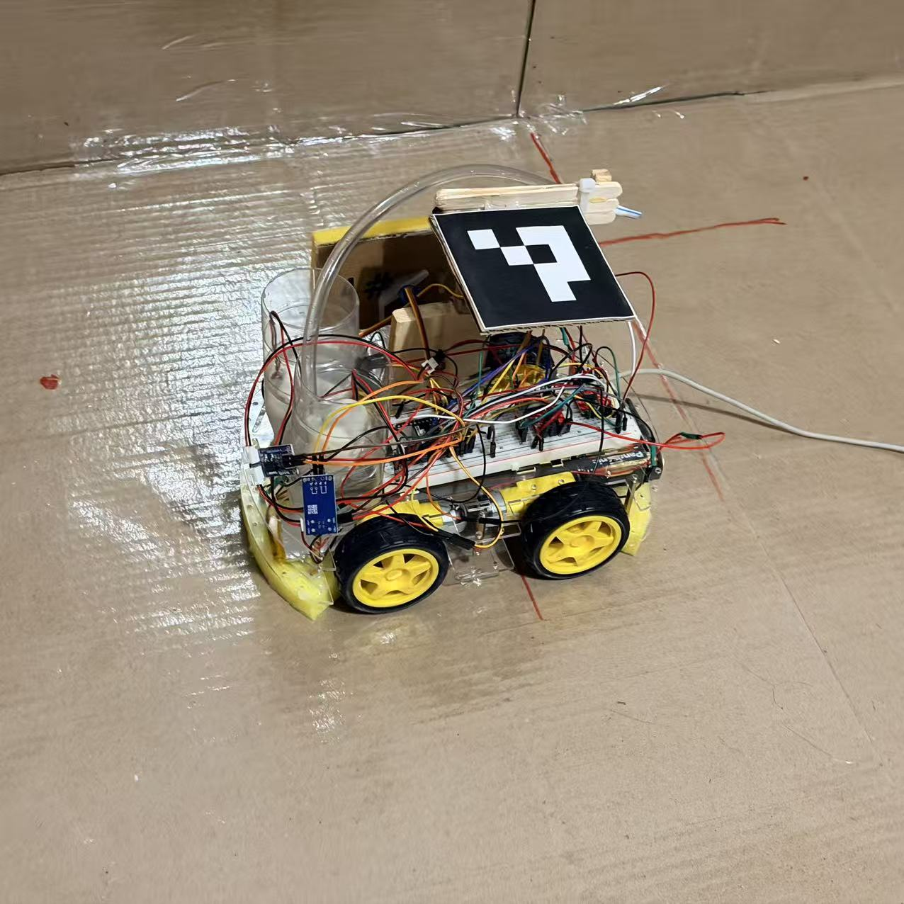

# BioGuard Hardware

BioGuard uses an ESP32-S3 controller on a four-wheel robot chassis, with pumps and servo-operated cleaning mechanisms. This page records the prototype using generic component descriptions where exact model numbers are unavailable.

## Component overview

| Component | Quantity | Role / description |
| --- | --- | --- |
| ESP32-S3 development board | 1 | Embedded controller; Wi-Fi communication with the computer |
| DC geared drive motors | 4, based on firmware | Drive the robot wheels; exact model and electrical ratings unconfirmed |
| Wheels and chassis | 1 chassis with 4 wheels | Mobile platform supporting electronics and cleaning equipment |
| Dual-channel motor driver modules | 2, based on firmware | Control the four drive motors; exact models unconfirmed |
| Miniature liquid pumps | 2, based on firmware | Select between two cleaning-fluid paths; voltage, power, and flow rate unconfirmed |
| Servo motors | 2, based on firmware | Lift the spray tubes and move the wall-cleaning sponge; models and torque ratings unconfirmed |
| Liquid reservoirs and flexible tubing | As fitted | Store and route cleaning liquid |
| Sponge / cleaning pads | As fitted | Contact cleaning surfaces |
| Pump switching modules | To confirm | External switching circuitry for pump control; exact device type unconfirmed |
| Breadboard and jumper wires | As fitted | Prototype electrical connections |
| Power supply and wiring | To confirm | Supply the controller, motors, pumps, and servos; voltage and current ratings pending |
| Printed visual marker | 1 visible | Marker mounted above the chassis for computer-side visual tracking |
| Supports and mounting materials | As fitted | Hold the marker, tubing, electronics, and cleaning mechanisms |

The ESP32-S3 is confirmed by the team. Motor, driver, pump, and servo quantities above follow the supplied firmware; the photo shows the assembled prototype but does not reveal every component or rating.

## How the hardware fits together

The computer communicates with the ESP32-S3 over Wi-Fi. The controller sends signals to motor drivers for movement, switches the selected liquid pump, and positions the spray and sponge servos. The photo shows the prototype chassis, tubing, breadboard wiring, cleaning materials, and elevated visual marker.

## Specifications and wiring

Exact part numbers are optional for this prototype overview. Electrical ratings should be recorded only when confirmed from a label, supplier listing, or measurement. Values such as **4 V** or **5 W** have not been established for these components and are not listed as specifications.

The pin assignments in [Config.h](../firmware/NatHack_Robot/Config.h) are explicitly marked as an example plan. They are not a verified wiring diagram. Actual wiring, power distribution, and component ratings still need to be documented.

## Current documentation status

This is a preliminary hardware inventory, not a complete reproduction guide. Add confirmed ratings, wiring diagrams, and test results as they become available. See the [firmware notes](../firmware/NatHack_Robot/README.md) for the missing protocol files and firmware/documentation version mismatch.
